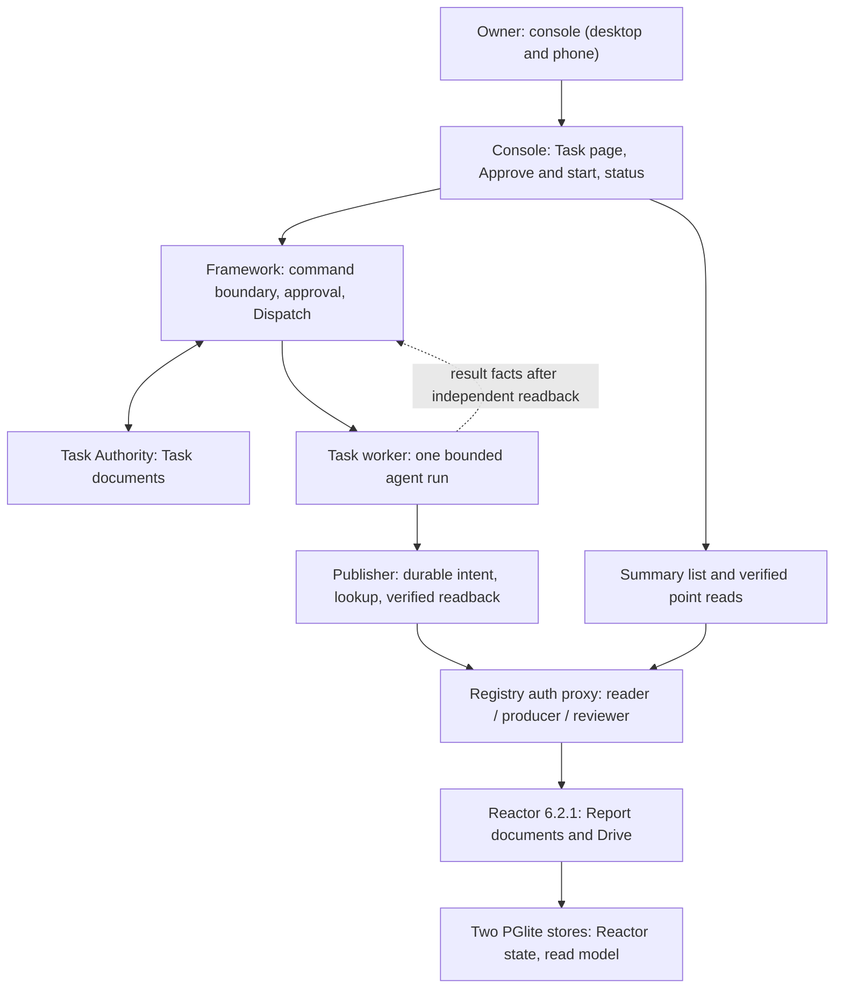
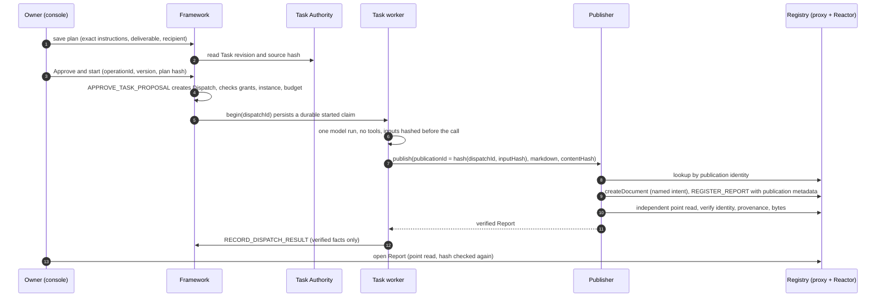

# Architecture

This document describes Kapelle as built: the components, how data moves between them, the publication protocol, the fences that protect writes, and how reads are separated from proof. It ends with engineering feedback for the Powerhouse team.

## Vocabulary

| Concept | Meaning | Lives in |
|---|---|---|
| **Task** | A commitment and its progress. A Report does not complete it. | `packages/task-authority` (Task document model) |
| **ReviewIntent** | A proposal and the owner's decision on it. The owner approves an exact proposal version and hash. | `packages/agent-framework/document-models/review-intent` |
| **Dispatch** | One authorized execution: who runs what, under which approval, and with what result. | `packages/agent-framework/document-models/dispatch` |
| **AgentDefinition / AgentInstance** | A versioned, immutable capability package, and the owner's configured, pinned agent with grants and budget. | `packages/agent-framework/document-models/agent-*` |
| **Report** | The durable result, with identity, provenance, a content hash, lifecycle and attention state. | `packages/report-registry/document-models/report-registry` |
| **Drive** | The Powerhouse container whose membership document lists the Reports. | Reactor |

Document type IDs are mixed: `kilgore/report` and `kilgore/task` predate the `kapelle/*` namespace, and they stay because existing documents carry them as protocol identity.

Producing a Report does not complete the Task. It also doesn't authorize the next external action. Each of those is a separate, explicit operation.

## Why document models fit agents

Typed, event-sourced document models are a strong foundation for agent-managed state. Kapelle doesn't let an agent mutate an arbitrary row or overwrite a file. It gives the agent a constrained vocabulary of operations. A reducer validates those operations and makes the resulting state reproducible under a particular model version. Review decisions, lifecycle transitions and attention changes become part of the history, not conventions kept outside it.

An agent's reasoning is not deterministic, but its authority and state transitions should be. Document models cannot make an LLM reproducible. They make the consequential state changes inspectable and replayable, and subject to explicit invariants. External tool effects still need their own adapters and evidence. The document history does not cover them automatically.

Kapelle adds four controls on top of that foundation:

- **Approval binds execution.** The owner approves one specific proposed Dispatch, with bounded capabilities and runtime checks. A language model cannot grant itself authority.
- **Results have provenance.** A Dispatch is tied to its Report's identity and content hash. A plausible-looking document or a matching title is not proof of a result.
- **Publication has an identity before it has a response.** Durable intents and reconciliation let the publisher tell a known refusal from an uncertain write. A lost reply does not justify creating a second Report.
- **Review is state.** Report lifecycle and attention operations keep generated, reviewed and actionable material distinct.

Rows and files can provide these properties, but then the application has to invent and maintain the operation grammar, the history, the validation and the replay rules itself. Document models make that contract explicit. They don't remove the need for authorization, concurrency control or careful handling of external effects.

## Components

**Console** (`console/`). A Next.js app. The owner is authenticated either through the private network (an identity header bound to one configured host) or with a scoped token. Approval is only as strong as that boundary. The slice in this repo covers the Task page's delegation panel and the server routes behind it. The owner sees the exact saved plan, approves it with one *Approve and start* action, watches the actual assignment, and opens the verified Report. The console never treats a timeout as absence. A lost response leads to a "Check status" read, never an automatic resend.

**Framework** (`packages/agent-framework`). The deterministic authority for agents and execution:

- `src/command-boundary.ts`: owner-only command preparation, current-fact validation and exact hashing. The caller supplies a stable operation ID, document ID, expected revision and operation input. The host supplies the actor and the time. Unknown fields are rejected.
- `src/service/`: the native authority (scoped Reactor mutations with durable receipts), an HTTP service and a SQLite journal.
- `src/task-delegation/`: proposals, approval, the launcher, the one-run worker, recovery and the Report adapter contract.
- `src/worker/`: the restricted Claude adapter (no tools, no browsing, no fallback), process ownership and writer locks.
- `src/publication/`: the Website publication effect path. It holds the project, reserves, stages, checks preflight, and keeps delivery evidence. It is built and tested, and deliberately kept out of the agent's authority.

**Task Authority** (`packages/task-authority`). The Task document model and a command gateway with idempotent receipts, a Drive lock and a projection for reads.

**Publisher** (`packages/report-registry/src`). Writes Reports into the Registry and proves them:

- `task-publication.ts`: the Task bridge. It derives the publication identity, persists a plan, and publishes or looks up under a deploy lock.
- `private-publication.ts`: create, register and verify against the Registry's MCP tools. Also model admission.
- `promote.ts` and `promotion-request.ts`: the general, producer-neutral promotion path with plan digests.
- `deploy-lock.ts`: a shared `flock` held across check → create → register → readback.

**Registry** (`packages/report-registry/deploy`). Runs next to the Reactor:

- `mcp-auth-proxy.ts`: a loopback-only authorization proxy with separate reader, producer and reviewer credentials, plus an admission control that suspends expensive listings.
- `report-summary-read/`: the read bridge. It provides a summary projection, point reads (`getReportDocumentV1`, `getReportDetailV2`), the native publication lookup (`lookupReportPublicationV1`) and deployment identity (`getRegistryDeploymentV1`).
- `report-listing-runtime/`: the composed snapshot tool and its pinned model inventory.

**Report model** (`packages/report-registry/document-models/report-registry`). Content, lifecycle and attention reducers. `v1/src/publication.ts` validates publication metadata: author, publisher, run, source, provenance, content hash and version.

## The delegated Task, step by step

What makes this safe:

1. **One claim, one invocation.** The worker commits a started claim to a synchronous SQLite journal before it calls the provider. A crash, timeout or lost response yields `EXECUTION_UNCERTAIN`, never a second run. Only local refusals that are provably pre-submission are retryable: a missing credential, or a refused private directory.
2. **Identity before response.** The publication identity is derived from the Dispatch and its input hash. After an ambiguous reply, the worker only looks up that identity. A lookup that says "absent" does not license another publish.
3. **Verification, not trust.** The Dispatch records a result only after an independent read matches the Report ID, owner and scope, Dispatch and source, producer, publication identity, content version and exact bytes.
4. **The Task stays open.** `REPORT_PUBLISHED` does not complete the Task, approve another effect or mark the Report as read.

Statuses visible to the owner are `EXECUTION_RUNNING`, `EXECUTION_UNCERTAIN`, `REPORT_PENDING` (output retained, Report not yet confirmed) and `RESULT_RECORDED` (Report verified).

## The publication protocol

Publication runs through four stages:

1. **Durable intent.** The plan, including request, admission and plan digest, is fsynced and installed exclusively with `link()` before any remote write. The intent's document name is derived from the publication identity: `kapelle-publication-<sha256>`.
2. **Allocation.** One `createDocument` with that name.
3. **Registration.** One `addActions` with `REGISTER_REPORT`, which carries content, producer and publication metadata.
4. **Verified readback.** An independent read with a separate reader credential, checked against the expected Report, provenance, content hash and publication metadata.

The publisher checks publication identity next to each write and records each outcome. When the outcome is uncertain, it stops instead of resending. A lost create response is reconciled by its retained intent name. A rejected registration is detected on readback, because MCP `addActions` can report success for an action the reducer rejected. This is a recovery protocol. It does not claim exactly-once execution in general.

The protocol exists twice. The TypeScript publisher (`packages/report-registry/src/task-publication.ts`) serves the Task worker. The console's owner-initiated publish path predates it and uses an owner-scoped Python journal (`scripts/report-publication/store.py`) with the same rules. This is duplication, not a feature; converging on one implementation is open work.

## Fences

**Model admission.** The previous Report model package (47 files; the current one has 49, so the packages are referred to by file count) silently dropped the `publication` field on `REGISTER_REPORT`. The write looked successful while losing the data the protocol depends on. Model compatibility therefore became a correctness gate. The publisher requires a `QUALIFIED_LIVE` admission that pins:

- the exact 49-file model inventory (`deploy/report-listing-runtime/model-inventory.json`);
- the schema hash;
- the endpoint and Drive;
- one Registry deployment.

The host re-reads the admission on every check, so withdrawing it takes effect immediately. A refused admission happens before inference, so a mismatched Registry does not cost a model run.

**Deployment identity.** `deployment.mjs` reports the release the Reactor process *actually* runs: a per-process `bootId`, the release ID and the model digest at boot and on disk now. Consumers require boot = current = admitted. A model swap needs a restart, which produces a new boot and a new digest.

**Deploy lock.** A proxy check alone cannot stop a model change between the check and the forwarded write. Publication therefore holds a *shared* lock from the admission check through readback. Deploying or restarting the Registry takes it *exclusively*. Immutable application releases are kept separate from mutable stores, caches, logs and secrets.

**Role separation.** The proxy separates reader, producer and reviewer credentials. Reports are not signed, so "verified" always means checked by an independent read inside the owner's system, not third-party attestation. These are role credentials, not per-Task capabilities: producer writes have broader authority than one approved Report. Task-specific restrictions therefore also live in the Framework and the publisher.

## Read paths: discovery is not proof

| Read | Used for | Proves |
|---|---|---|
| `GET /v2/report-summaries` (summary projection) | Today, the Report list | Nothing on its own. It doesn't authorize a Task result link, and it doesn't prove a publication is absent. |
| `getReportDocumentV1` / `GET /v2/reports/:id` (point read) | Opening one Report, publisher readback | Identity, metadata and content hash, checked by the caller against what it expected. |
| `lookupReportPublicationV1` | Reconciling a publication identity | Presence. It fails closed when the lookup can't be verified. |
| `getReportLibraryMetadata` (full-Drive listing) | Legacy listing | Too expensive at scale. The proxy suspends it under load (`503 listing_suspended`). |

On the console side, `reportSelectedSource.ts` and `reportRegistryContract.ts` validate the returned document in full. They check lifecycle, MIME type, byte size, inline-only content and SHA-256 of the exact bytes before anything is shown as a verified Report.

## Scale, as measured

The live Registry holds about **2,450 Report members and 15,000 operations** in a store of roughly **400 MB**. Membership is not a count of finalized Reports. The store also contains blank intent documents and rejected operations.

| Measurement (synthetic, loopback, Reactor 6.2.1 + PGlite) | 1,000 Reports | 2,500 Reports |
|---|---|---|
| Full-Drive listing | about 2.7 s | fails at 12–13 s (6 s limit) |
| `lookupReportPublicationV1` | about 0.15 s | about 0.5 s |
| Summary projection | about 0.3 s | about 0.8 s |
| Point read through the proxy | about 12 ms | not sampled |
| **Publish + independent readback with the read bridge** (quiet) | **6.3 s** | **6.9 s** |
| Same, with a competing full-listing poller | 8.4 s | 6.7 s |
| Full-Drive listings on the publication path | 0 | 0 |

Before the bridge, one publication made about 24 full-Drive listings, roughly two minutes at live scale.

## What hurt, and what would help

This section is written for the Powerhouse team.

**Read latency becomes availability.** PGlite's single connection let a long listing block small detail reads. Full listings took roughly 12–13 seconds at about 2,500 synthetic Reports, beyond our six-second limit, and earlier publications needed about 24 listings. We have moved to summary and point reads. Postgres support for both stores already exists in 6.2.1, so the remaining work is ours: qualifying the migration and measuring concurrent reads and writes. [Storage paths](https://github.com/powerhouse-inc/powerhouse/blob/v6.2.1/apps/switchboard/src/server.mts).

**Persistence cost grows with the whole store.** Our AtomicNodeFs integration rewrites the snapshot even during read-only passes. Synthetic write throughput fell below one operation per second above roughly 2,000 Reports. The development line replaces this with durable NodeFS and snapshot conversion for both stores, which addresses our bottleneck directly. We need to qualify conversion, durability and restore on our captured corpus before adopting it. [NodeFS change](https://github.com/powerhouse-inc/powerhouse/commit/b5126c30566a).

**Drive membership is a scaling boundary.** Our V1 lookup still validates the whole membership document. It is bounded at 3,000 nodes and 2 MB of nodes JSON; those are our limits, not Reactor limits. The new reactor-drive relationship membership and indexed keyset listings offer a better direction. We still need a migration contract, plus a publication-identity lookup whose negative result proves absence even while projections catch up. [Listing indexes](https://github.com/powerhouse-inc/powerhouse/pull/3229), [legacy membership migration](https://github.com/powerhouse-inc/powerhouse/blob/e15e49f18ba5/packages/reactor-drive/src/migration/migrate-legacy-state.ts).

**Production packaging needs a clear contract.** Our `vetra --dev` rehearsal failed when Vite wrote its cache inside a read-only application directory. The new Switchboard runner offers production loaders, and desktop packaging separates built assets from runtime state. We want to qualify that headless path for our Report package. Connect's static-serving path still uses Vite preview. A documented production-support and writable-directory contract would help. [Switchboard runner](https://github.com/powerhouse-inc/powerhouse/blob/e15e49f18ba5/clis/ph-cli/src/runners/switchboard.ts), [Connect runner](https://github.com/powerhouse-inc/powerhouse/blob/e15e49f18ba5/clis/ph-cli/src/runners/connect.ts).

**Errored heads need explicit semantics.** Our capture has nine errored operations and four errored heads. They include blank drafts and a Report with valid prior content. One rejected action anywhere on the Drive made our V1 lookup fail closed for every publication identity. Recent replay and projection fixes are encouraging. We still need to tell accepted state, current head and projection readiness apart, without presenting a rejected registration as a successful publication. [Projection correction](https://github.com/powerhouse-inc/powerhouse/commit/8508e74ad6f9).

**Model compatibility needs an execution-time guard.** An older model silently dropped required publication metadata, which is why we built the admission and deployment fences. Upstream now validates document-upgrade version and revision preconditions. We would like an equivalent model-digest precondition for ordinary create and register writes, so an incompatible write is refused before it mutates anything. [Upgrade preconditions](https://github.com/powerhouse-inc/powerhouse/commit/c320f464abde).

### Questions for Powerhouse

1. **Storage migration.** Which release do you recommend for adopting durable NodeFS on an existing two-store snapshot deployment? What backup, conversion and rollback procedure do you support? Should this come before Postgres?
2. **Membership and lookup.** Should we migrate legacy Drives through `migrateLegacyDriveState`? What freshness guarantee would let an indexed negative result safely authorize a unique publication create?
3. **Production runtime.** Can a built Report package run under the Switchboard production loader with an immutable application directory? What are the supported writable locations? Is Connect's Vite preview supported for production?
4. **Agent infrastructure.** Clint (Powerhouse's agent runner) now manages agents, and Mastra attaches to a persistent Reactor. Where should scoped authority, human approval, revocation and durable Task and result provenance live? We could contribute our approved-Dispatch → verified-Report journey as an integration case. [Agent runner](https://github.com/powerhouse-inc/powerhouse/commit/532cb2128fd1).
5. **Write and read correctness.** Can the executor extend upgrade preconditions and atomic append read sets to require an admitted model digest on arbitrary writes? What should clients treat as authoritative when a rejected operation leaves a newer errored head?
